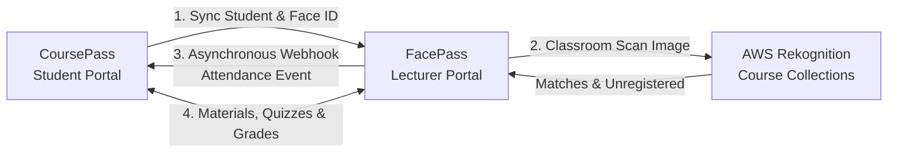

# FacePass Product Requirements & Engineering Guidelines

This skill guides the implementation, testing, and maintenance of **FacePass**, the lecturer-facing automated attendance and course management system, and its integration with **CoursePass** (the companion student portal) and **AWS Rekognition**.

For the complete verbatim document, see [references/prd.md](references/prd.md).

---

## 1. System Architecture & Boundaries

- **FacePass (Lecturer Portal):**
  - Owns course creation, lecturer collaboration, live classroom scanning, attendance logs, eligibility calculation, material distribution, quiz scheduling, and audit reports.
  - **Does NOT handle**: Student registration or raw biometric registration/uploads.
- **CoursePass (Student Portal):**
  - Source of truth for student accounts, biometric image uploads, and Rekognition indexing.
  - Receives real-time attendance webhooks and WebSocket notifications.
- **AWS Rekognition:**
  - Performs 1:N facial searches against compartmentalized per-course collections.

---

## 2. Core Functional Requirements Checklist

### Course Management
- [ ] **Metadata**: Every course must record `academic_session` (e.g. "2026/2027") and `total_classes` (baseline for 75% eligibility).
- [ ] **Multi-Lecturer**: Support inviting co-lecturers/senior lecturers with permissions to scan attendance, upload materials, and schedule quizzes.
- [ ] **Multi-Course**: A single lecturer can create and manage unlimited courses.

### Attendance & AWS Rekognition
- [ ] **Per-Course Face Collections**: Each course has its own compartmentalized AWS Rekognition collection for low latency and zero cross-course false positives.
- [ ] **Verification & Marking**: Scanned faces matched in the course collection are marked "Present".
- [ ] **Intruder / Unregistered Detection**: Any detected face not matched to the course roster triggers an immediate "Unregistered Student" alert on the lecturer's screen.
- [ ] **Cloud-Only Biometrics**: No face images stored on lecturer client devices.

### Dashboard & Analytics
- [ ] **Metrics Display**: Paginated roster showing Matric No, Department, Level, Total classes attended, Attendance ratio (`attended / total_classes`), and 75% Eligibility status.
- [ ] **CSV Archival Export**: Complete attendance roster and metrics downloadable as CSV.

### Student Auditing
- [ ] **Search & Filter**: By Matric Number, Department, or Level.
- [ ] **Audit Trail**: Chronological log of attendance (timestamped Present/Absent) and combined quiz performance report.
- [ ] **Export**: Individual student audit report download.

### Course Communication & Quizzes
- [ ] **Materials**: Upload lecture notes (PDF, DOCX), links, announcements; synced to CoursePass.
- [ ] **Quizzes**: Schedule/unschedule with date/time, toggle Graded/Ungraded, view grade distributions and analytics.

### CoursePass Integration & Webhooks
- [ ] **Enrollment API**: Ingest student profile payload (`student_id`, `name`, `department`, `face_id`, `course_id`) from CoursePass.
- [ ] **Attendance Webhook**: Fire asynchronous event to CoursePass upon logging "Present". CoursePass pushes real-time WebSocket alert to the student.
- [ ] **Quiz Sync**: Push quizzes to CoursePass; receive student quiz submissions and grades.

---

## 3. Security & Operational Rules

1. **Compartmentalized Collections**: Always scope AWS Rekognition collection IDs to the course (e.g., `facepass_course_<course_id>`).
2. **Device Privacy**: Do not persist raw camera/face frames to local lecturer storage or unencrypted disks.
3. **Authentication**: All service-to-service endpoints between FacePass and CoursePass must use API Key or OAuth 2.0 Client Credentials verification.
4. **Encryption**: All payloads in transit must enforce TLS 1.3.
